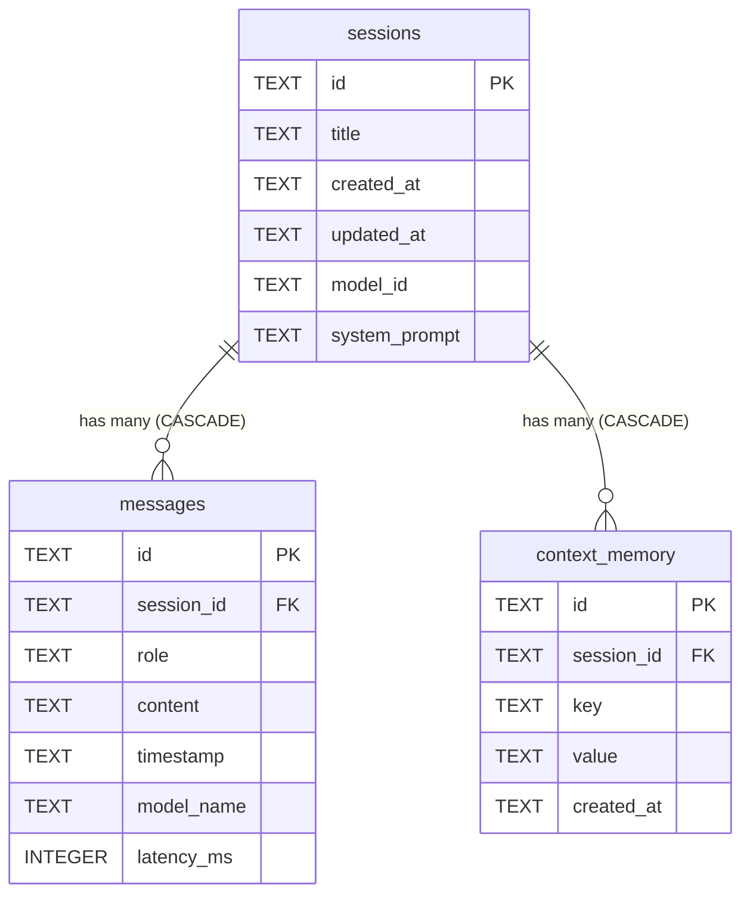
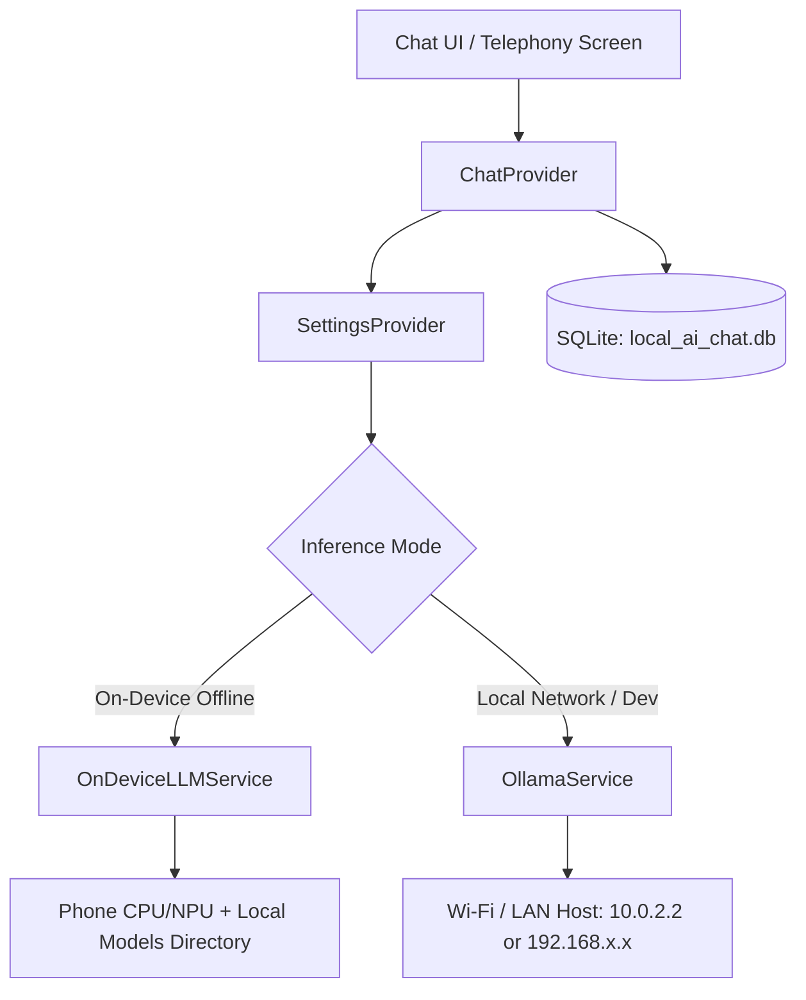

# 01_local_ai_chat_summary.md — Phase 1: On-Device AI Chatbot & Context Memory

## 1. Sub-Project Overview

- **Project Name:** Local AI Chat
- **Folder:** `01_local_ai_chat/`
- **Application ID:** `com.localcallai.local_ai_chat`
- **Role in Suite:** Standalone on-device AI chatbot designed to be published on the Google Play Store as an independent app and serve as the **conversational reasoning brain** for the downstream call assistants (Phase 4 & Phase 5).
- **Core Philosophy:** **100% On-Device & Zero Cloud.** The model runs directly on the phone hardware and all conversations, context, and caller memory are stored in a native, encrypted on-device SQLite database.

---

## 2. On-Device LLM: Why Qwen 2.5 on Mobile?

Running an LLM locally on an Android phone (like Samsung Galaxy A56 5G) or iPhone requires balancing memory (RAM), battery draw, thermal dissipation, and response latency:

| Model Variant | Quantization | RAM Required | Phone Hardware Suitability | Role in LocalCall AI |
| :--- | :--- | :--- | :--- | :--- |
| **Qwen 2.5 0.5B Instruct** | Q4_K_M (GGUF) | **< 600 MB RAM** | **Compatible with 100% of Android & iOS phones** | **Primary default model.** Near-zero latency (<150ms time-to-first-token), essential for real-time speech responses during phone calls. |
| **Qwen 2.5 1.5B Instruct** | Q4_K_M (GGUF) | **~1.4 GB RAM** | Mid-range phones (4GB–6GB RAM) | Enhanced conversational depth, precise instruction following, and multilingual support. |
| **Qwen 2.5 3B Instruct** | Q4_K_M (GGUF) | **~2.4 GB RAM** | Flagship phones (8GB+ RAM) | High-level synthesis, reasoning, and automated email/note drafting. |

---

## 3. SQLite Database Architecture (`local_ai_chat.db`)

All conversational history, turns, and context memory are managed locally through `sqflite` with foreign key enforcement and indexing.



### Table Definitions

1. **`sessions` Table:**
   - `id TEXT PRIMARY KEY`: Unique UUIDv4 identifying the conversation.
   - `title TEXT NOT NULL`: Conversation title (automatically derived from the first user inquiry or call subject).
   - `created_at TEXT NOT NULL`, `updated_at TEXT NOT NULL`: Timestamps for sorting and retention policies.
   - `model_id TEXT NOT NULL`: Model tag utilized (e.g. `qwen2.5:0.5b`).
   - `system_prompt TEXT NOT NULL`: System prompt or persona assigned to this session.

2. **`messages` Table:**
   - `id TEXT PRIMARY KEY`: Unique message UUIDv4.
   - `session_id TEXT NOT NULL`: References `sessions(id)` with `ON DELETE CASCADE`.
   - `role TEXT NOT NULL`: Message role (`user`, `assistant`, `system`).
   - `content TEXT NOT NULL`: The text body (supports Markdown and code).
   - `timestamp TEXT NOT NULL`: Exact message timestamp.
   - `model_name TEXT`: The model that generated this message.
   - `latency_ms INTEGER`: Generation turnaround time in milliseconds (latency benchmark).
   - **Index:** `CREATE INDEX idx_messages_session_id ON messages(session_id)` for instant lookups.

3. **`context_memory` Table:**
   - `id TEXT PRIMARY KEY`: Compound key `${sessionId}_${key}`.
   - `session_id TEXT NOT NULL`: References `sessions(id)` with `ON DELETE CASCADE`.
   - `key TEXT NOT NULL`: Fact identifier (e.g., `caller_name`, `call_reason`, `urgency_level`, `callback_date`).
   - `value TEXT NOT NULL`: Extracted context value.
   - `created_at TEXT NOT NULL`: Fact capture timestamp.

---

## 4. Multi-Engine Runtime Architecture

The app includes a dual-engine architecture managed via `SettingsProvider`:



- **Mode 1: On-Device (Offline)**
  - Runs directly on the mobile device processor.
  - Checks the app documents directory (`app_flutter/models/*.gguf`).
  - Completely offline with zero internet permission required during inference.
- **Mode 2: Local Network / Ollama**
  - Connects to Ollama running on your home Wi-Fi network (or `10.0.2.2:11434` on Android emulator).
  - Used for developer benchmarking, testing larger parameter models (e.g. 7B/14B), and cross-checking prompt outputs.

---

## 5. File Structure of `01_local_ai_chat`

```
d:\Build LocalCall AI\01_local_ai_chat/
├── 01_local_ai_chat_summary.md        # This deep architectural summary
├── README.md                          # Quick start and setup guide
├── pubspec.yaml                       # Dependencies: sqflite, provider, http, etc.
├── android/
│   ├── app/src/main/AndroidManifest.xml # Permissions (INTERNET, ACCESS_NETWORK_STATE)
│   └── gradle/wrapper/gradle-wrapper.properties # Gradle 8.14 for Java 24 compatibility
├── lib/
│   ├── main.dart                      # Application bootstrap & MultiProvider
│   ├── models/
│   │   ├── chat_message.dart          # Message entity & JSON/Map serialization
│   │   ├── chat_session.dart          # Session entity
│   │   └── llm_model_info.dart        # Specs for Qwen 2.5 (0.5B, 1.5B, 3B) & Llama 3.2
│   ├── services/
│   │   ├── database_helper.dart       # SQLite database engine (tables, CRUD, cascade)
│   │   ├── llm_service.dart           # Abstract streaming LLM contract
│   │   ├── on_device_llm_service.dart # On-device autonomous inference & GGUF detector
│   │   ├── ollama_service.dart        # Streaming NDJSON HTTP client
│   │   └── storage_service.dart       # SharedPreferences key-value storage
│   ├── providers/
│   │   ├── chat_provider.dart         # SQLite-backed conversation manager & streaming
│   │   └── settings_provider.dart     # Engine mode toggle, model selector, & host config
│   ├── widgets/
│   │   ├── chat_bubble.dart           # Markdown message bubble with copy & latency pill
│   │   ├── chat_input_bar.dart        # Auto-expanding input with quick action prompts
│   │   ├── connection_badge.dart      # Real-time connection status badge
│   │   └── model_selector_sheet.dart  # Modal bottom sheet for model selection
│   └── screens/
│       ├── chat_screen.dart           # Main conversation screen with auto-scrolling
│       ├── settings_screen.dart       # Engine mode, server URL, persona, & temperature
│       └── history_screen.dart        # History drawer with search & session deletion
└── test/
    └── widget_test.dart               # Unit tests verifying serialization & model configs
```

---

## 6. How this Prepares for Phase 4 & Phase 5

1. **Pre-Configured Phone Screening Persona:**
   - The settings screen includes a specialized prompt:
     > *"You are the autonomous AI phone agent for this device. A caller is reaching out because the owner is unavailable. Greet them warmly, state that you are an AI assistant taking a message, ask who is calling and the reason for their call, and reassure them that their message will be delivered with a structured summary."*
2. **Context Memory Table:**
   - When the caller speaks, their name, inquiry, and callback urgency are extracted and saved directly into `context_memory` in SQLite.
3. **Pluggable Architecture:**
   - In Phase 4, the input text to `ChatProvider.sendMessage()` will come directly from the **Speech-to-Text (STT)** engine instead of the keyboard, and the streamed output will feed directly into the **Text-to-Speech (TTS)** engine back to the caller.
