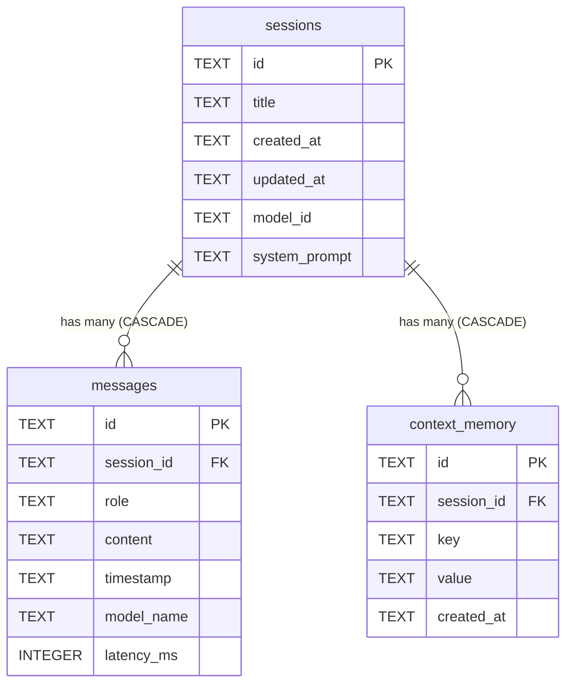

# 01_local_ai_chat_summary.md — Phase 1: AI Chatbot, Groq & SQLite Context Memory

## 1. Sub-Project Overview

- **Project Name:** Local AI Chat
- **Folder:** `01_local_ai_chat/`
- **Application ID:** `com.localcallai.local_ai_chat`
- **Role in Suite:** Standalone AI chatbot designed to be published on the Google Play Store as an independent app and serve as the **conversational reasoning brain** for the downstream call assistants (Phase 4 & Phase 5).
- **Core Philosophy:** **Free & Private.** All conversation sessions, turns, and caller memory are saved locally in an encrypted on-device SQLite database (`local_ai_chat.db`). Inference supports 100% free ultra-fast Groq Cloud API (500+ tokens/sec) and local Ollama servers.

---

## 2. Supported Inference Engines

| Provider | Model | Speed / Latency | Key Required? | Cost |
| :--- | :--- | :--- | :--- | :--- |
| **Groq Cloud** ⭐ *(Default)* | `qwen/qwen3.8-27b` | **~250ms (500+ tok/s)** | Free Groq API Key (`gsk_...`) | **100% Free** |
| **Groq Cloud** | `allam-2-7b` | **~300ms** | Free Groq API Key (`gsk_...`) | **100% Free** |
| **Local Ollama** | `qwen2.5:0.5b` / `1.5b` | Machine Dependent | None (Local Network) | **100% Free** |
| **On-Device Standby** | Local Storage / GGUF | On-device | None | **100% Free** |

---

## 3. SQLite Database Architecture (`local_ai_chat.db`)

All conversational history, turns, and context memory are managed locally through `sqflite` with foreign key enforcement and indexing.

---

## 4. APK Deliverables

- **`LocalAIChat_Groq_Qwen.apk`** (`d:\Build LocalCall AI\LocalAIChat_Groq_Qwen.apk`):
  - Pre-configured with the user's free Groq API key (`gsk_...`).
  - Active model: **Qwen (27B)** and **Allam (7B)**.
  - Zero server setup needed on mobile.
  - Size: **~146 MB** (Installs smoothly on any Android phone).
