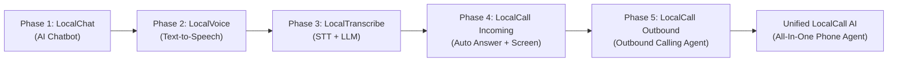

# LocalCall AI — Master Project Roadmap & Architectural Summary

## 1. Executive Summary

**LocalCall AI** is an end-to-end, privacy-focused voice intelligence ecosystem designed to run on-device and locally. The final vision is an autonomous AI phone assistant on Android that:
- Detects incoming cellular and VoIP calls.
- Waits for a designated timeout or ring threshold (e.g., 3 rings without user pickup).
- Automatically answers the call on your behalf.
- Converses naturally with the caller as an authorized AI representative.
- Transcribes and records the conversation locally.
- Generates a structured call summary with key takeaways and action items.
- Sends instant notifications and retains complete audio/text history on-device.

Rather than building a single monolithic codebase with high risk of failure, this project is divided into **5 standalone, production-ready, publishable Flutter applications** that progressively build and de-risk each subsystem. Each phase produces a complete Google Play Store-ready product.

---

## 2. Workspace & Folder Structure

Each phase will reside in its own dedicated workspace folder inside `d:\Build LocalCall AI\`:

```text
d:\Build LocalCall AI\
├── summary.md                             # Master project roadmap & documentation (this file)
├── 01_local_chat/                         # Phase 1: Standalone AI Chatbot (Ollama / Local LLM)
├── 02_local_voice/                        # Phase 2: Standalone Text-to-Speech (TTS) Studio
├── 03_local_transcribe/                   # Phase 3: Speech-to-Text (STT) + Local LLM Intelligence
├── 04_local_call_incoming/                # Phase 4: Incoming Phone Call Assistant (Telecom + AI)
└── 05_local_call_outbound/                # Phase 5: Outbound Voice Agent & Automated Caller
```

---

## 3. Product Phases & Deliverables



### Phase 1: LocalChat (AI Chatbot)
- **Target Folder:** `01_local_chat/`
- **Goal:** Standalone Flutter mobile chatbot powered by local LLMs (Ollama / LiteRT / on-device runtime) with cloud fallback options.
- **Key Features:**
  - Pluggable LLM interface (Local Ollama server via Wi-Fi/LAN, on-device GGUF / LiteRT, or API fallback).
  - Material 3 conversational UI with streaming markdown and code syntax highlighting.
  - Multi-session chat history, conversation export, and customizable system prompts.
  - Persona management (Executive Assistant, Friendly Companion, Technical Advisor).
- **Play Store Ready:** Yes — a complete personal AI chat assistant.

### Phase 2: LocalVoice (Text to Speech Studio)
- **Target Folder:** `02_local_voice/`
- **Goal:** Standalone speech synthesis application to master on-device voice generation.
- **Key Features:**
  - High-quality offline speech synthesis (Android native TTS, Sherpa-onnx / Piper offline neural voices).
  - Fine-grained controls: pitch, speech rate, tone, pause duration, and language selection.
  - Audio export (`.wav` / `.m4a`), voice bookmarking, and speech preview playback.
  - Low-latency generation engine designed for conversational response times.
- **Play Store Ready:** Yes — useful for accessibility, audiobooks, content creators, and voice notes.

### Phase 3: LocalTranscribe (Speech to Text + LLM Reasoning)
- **Target Folder:** `03_local_transcribe/`
- **Goal:** Real-time voice transcription fused with local LLM intelligence.
- **Key Features:**
  - On-device speech recognition (whisper.tflite / Vosk / Android SpeechRecognizer).
  - Live transcription with silence detection and voice activity detection (VAD).
  - Immediate LLM processing: converts raw transcripts into summaries, action items, meeting minutes, and tone analysis.
  - Audio file import & live microphone recording.
- **Play Store Ready:** Yes — a dedicated AI Voice Recorder & Meeting Transcriber.

### Phase 4: LocalCall Incoming (AI Call Attendant)
- **Target Folder:** `04_local_call_incoming/`
- **Goal:** Real-time incoming phone call interception, auto-answer, and interactive AI voice dialog.
- **Key Features:**
  - Android `InCallService` and `TelecomManager` integration.
  - Configurable auto-answer trigger (e.g., answer after 3 rings / 12 seconds if unanswered).
  - Audio routing bridge: caller audio -> STT -> Local LLM -> TTS -> call audio stream.
  - Live call screening interface showing real-time transcript on the screen while the AI speaks.
  - Post-call intelligence: instant push notification with caller identity, transcript, summary, and action items.
  - Call recording storage with playback controls.
- **Play Store Ready:** Yes (or enterprise/sideload depending on Android carrier role permissions).

### Phase 5: LocalCall Outbound (Autonomous Voice Calling Agent)
- **Target Folder:** `05_local_call_outbound/`
- **Goal:** Automated outbound calls with dynamic AI conversation agents.
- **Key Features:**
  - Goal-oriented prompt configurations (e.g., appointment booking, inquiry, status check).
  - Automated dialing through telephony / VoIP bridge.
  - Interrupt handling & turn-taking management.
  - Post-call execution logs and structured result reports.
- **Play Store Ready:** Yes.

---

## 4. Technology Architecture

| Component | Technology | Role & Justification |
| :--- | :--- | :--- |
| **Mobile Framework** | Flutter (Dart 3.x) | High performance, cross-platform UI, native platform channels for Android Telecom |
| **Local LLM Engine** | Ollama (Local Network) / LiteRT / GGUF | Completely offline reasoning without third-party cloud dependencies |
| **Speech-to-Text (STT)** | On-device Whisper / Vosk / Android Speech | Converts caller voice to text in real time with low latency |
| **Text-to-Speech (TTS)** | Android TextToSpeech / Piper / Sherpa-ONNX | Generates human-like speech output to the caller |
| **Telephony Services** | Android `InCallService` & `CallScreeningService` | Detects calls, rings, answer/hangup actions, and state transitions |
| **Local Database** | SQLite / Isar / Hive | Encrypted local storage for transcripts, summaries, and audio recordings |
| **State Management** | Riverpod / Bloc | Clean reactive state separation between telephony, audio, and UI |

---

## 5. Critical Android Platform Considerations

1. **Default Dialer Role (`android.app.role.DIALER`):**
   - For an app to intercept incoming calls, silence ringtones, and trigger auto-answer, Android requires the app to register as a dialer and request user approval.
2. **Two-Way Cellular Audio Access:**
   - Standard third-party Android apps face OS-level sandbox limits on capturing raw upstream and downstream cellular audio simultaneously.
   - We will support:
     - **Direct Audio Stream Hooking:** Validated against the target test device (e.g., Samsung Galaxy A56 on Android 16).
     - **VoIP / SIP Bridge:** Allows full audio stream control for testing and carrier-independent usage.
     - **Conditional Call Forwarding:** Forwards unanswered calls to a local/controlled private endpoint if OEM firmware blocks cellular audio capture.
3. **Turn-Taking & Latency:**
   - Real-time voice interaction requires low latency (<1.5s total roundtrip from speech end to TTS start). Fast VAD (Voice Activity Detection) and compact quantized models (1B-3B parameters) are essential.

---

## 6. Execution Roadmap

- [x] **Project Scoping & Architecture Plan:** Completed.
- [ ] **Phase 1 (01_local_chat):**
  - Initialize Flutter project with clean MVVM/Riverpod architecture.
  - Implement pluggable LLM interface (Ollama + fallback).
  - Build modern chat UI with streaming responses, conversation history, and settings.
  - Verify and package for testing.
- [ ] **Phase 2 (02_local_voice):**
  - Initialize Flutter TTS app with offline speech engines.
  - Build audio playback, pitch/rate controls, and WAV/MP3 export.
- [ ] **Phase 3 (03_local_transcribe):**
  - Integrate microphone recording with offline STT.
  - Link STT output into LLM pipeline for instant summarization.
- [ ] **Phase 4 (04_local_call_incoming):**
  - Build Android native Kotlin plugin for `InCallService`.
  - Implement auto-answer after timeout/ring count.
  - Connect full STT -> LLM -> TTS conversational loop to active call.
- [ ] **Phase 5 (05_local_call_outbound):**
  - Implement outbound dialing agent and conversational script handlers.
- [ ] **Final Integration:**
  - Unify all modules into the ultimate **LocalCall AI** application.
